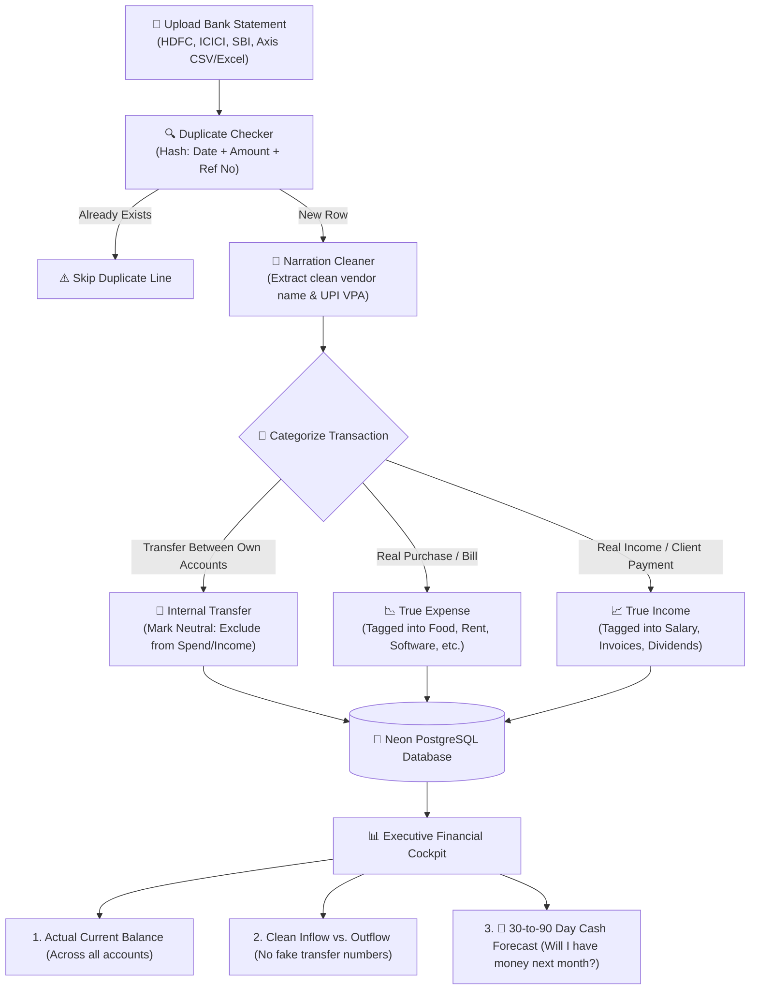

# CFO Review, Plain-English Guide & Product Roadmap for A-Count

> **Author**: 20+ Year MNC Chief Financial Officer (Treasury, Corporate Finance & Liquidity Management)  
> **Target Application**: [A-Count Bank Statement Intelligence](file:///c:/Users/hardi/OneDrive/Desktop/a-count)  
> **Purpose**: A clear, jargon-free guide on how money really works, where personal finance apps fall short, and the exact step-by-step roadmap to turn A-Count into a world-class financial workstation.

---

## 1. What You Have Built (The Good Stuff)

Your application has strong fundamentals:
* **High-Density, Modern UI**: The layout in [`app/DashboardClient.tsx`](file:///c:/Users/hardi/OneDrive/Desktop/a-count/app/DashboardClient.tsx) feels fast, crisp, and professional (Mercury/Swiss fintech aesthetics).
* **Smart Statement Parsing**: In [`lib/parsers/csv.ts`](file:///c:/Users/hardi/OneDrive/Desktop/a-count/lib/parsers/csv.ts), you automatically map columns from raw Indian bank statements (HDFC, ICICI, SBI).
* **UPI & Narration Cleaner**: In [`lib/tagger/upi.ts`](file:///c:/Users/hardi/OneDrive/Desktop/a-count/lib/tagger/upi.ts), you strip out ugly bank narration codes into human-readable merchant names (e.g., turning `UPI/4281903/Swiggy-Bangalore` into `Swiggy`).

---

## 2. The 4 Big "Gotchas" (Where Basic Apps Mislead Users)

Most money tracking apps give a false picture of wealth because they treat every bank row the same. Here are the 4 biggest traps:

### 1. The "Left Pocket to Right Pocket" Trap (Self-Transfers)
* **The Scenario**: You transfer ₹50,000 from your HDFC Savings account to your ICICI Business account to pay expenses.
* **What your app does right now**:
  * HDFC statement shows: **₹50,000 Outflow (Expense)**
  * ICICI statement shows: **₹50,000 Inflow (Income)**
  * Result: The dashboard says you spent ₹50k more and earned ₹50k more!
* **The Reality**: You didn’t make any money, nor did you spend any. You just moved cash from your left pocket to your right pocket.
* **The Solution**: An **Internal Transfer Detector**. When ₹50,000 leaves Account A and enters Account B around the same date, label it `Transfer` and exclude it from the Income and Expense totals.

### 2. The "Rearview Mirror" Trap (Looking Back vs. Looking Ahead)
* **The Scenario**: Your dashboard tells you what you spent last month.
* **The Analogy**: Driving a car while only staring into the rearview mirror. You will crash into the tree in front of you.
* **The Reality**: Knowing what you spent on Swiggy last week doesn't tell you if you will have enough cash to pay Rent or Payroll in 3 weeks.
* **The Solution**: A **13-Week Future Runway (Cash Forecast)**. 
  $$\text{Future Cash} = \text{Current Bank Balance} + \text{Expected Inflows} - \text{Known Upcoming Bills}$$

### 3. The "Ghost Balance" Trap (Bank Balance $\neq$ Spendable Money)
* **The Scenario**: Your bank portal says you have ₹1,00,000 today. But you just wrote a ₹40,000 check for rent yesterday that hasn't cleared yet.
* **The Reality**: You only have ₹60,000 of real spendable cash. If you spend ₹70,000 today, your check will bounce.
* **The Solution**: Show two balance numbers:
  * **Statement Balance** (what the bank sees).
  * **Available Cash** (what is actually safe to spend after pending bills).

### 4. The "Accidental Duplicate" Trap
* **The Scenario**: A user imports an HDFC statement from Jan 1 to Jan 31. Next week, they download a statement from Jan 15 to Feb 15 and drop it in.
* **The Reality**: The 15 days in the middle get imported twice, doubling their expenses and ruining their analytics.
* **The Solution**: Compute a unique fingerprint for every transaction: `Date + Amount + Reference No`. If it already exists in the database, automatically skip it.

---

## 3. CFO "Do’s and Don'ts" Cheat Sheet

```
┌─────────────────────────────────────────────────────────────┬─────────────────────────────────────────────────────────────┐
│                      DO (FINANCIAL ACCURACY)                │                  DON'T (AVOID AT ALL COSTS)                 │
├─────────────────────────────────────────────────────────────┼─────────────────────────────────────────────────────────────┤
│ 1. Filter out internal transfers from your P&L totals.      │ 1. Count moving money between your own accounts as income.  │
│ 2. Project future cash flow for the next 30 to 90 days.     │ 2. Only show past historical spending graphs.               │
│ 3. Check for duplicate rows before inserting into database. │ 3. Blindly append every row from every uploaded file.       │
│ 4. Separate "Personal" accounts from "Business" accounts.   │ 4. Mix company tax/payroll money with personal groceries.   │
│ 5. Keep an audit log of any edits or deletions.             │ 5. Allow silent, untracked deletions of financial records.  │
└─────────────────────────────────────────────────────────────┴─────────────────────────────────────────────────────────────┘
```

---

## 4. How Data Should Flow (Mermaid Diagram)



---

## 5. Scope of Work (SOW): Phased Implementation

### Phase 1: Immediate Quick Fixes (1–2 Days)
- [ ] **Transaction Deduplication in [`lib/parsers/csv.ts`](file:///c:/Users/hardi/OneDrive/Desktop/a-count/lib/parsers/csv.ts)**:
  - Generate a unique hash for each row: `account_id + date + amount + ref_no`.
  - Prevent duplicate imports when users upload overlapping date ranges.
- [ ] **Internal Transfer Neutralizer**:
  - Add an `'internal_transfer'` tag.
  - In [`app/DashboardClient.tsx`](file:///c:/Users/hardi/OneDrive/Desktop/a-count/app/DashboardClient.tsx), exclude transfers from the Total Inflow and Total Outflow KPI cards.

### Phase 2: Forward-Looking Cash Forecast (1–2 Weeks)
- [ ] **Recurring Bills & Incomes Detector**:
  - Automatically identify recurring expenses (e.g., Rent on the 1st, SIP on the 5th, Subscriptions on the 15th).
- [ ] **13-Week Cash Forecast Widget**:
  - A forward-looking chart projecting weekly cash balance over the next 3 months:
    $$\text{Week } N \text{ Cash} = \text{Week } (N-1) \text{ Cash} + \text{Expected Inflows} - \text{Scheduled Bills}$$
- [ ] **Low Cash Alert**:
  - Trigger a visual warning if projected cash drops below a user-defined safety threshold (e.g., ₹50,000).

### Phase 3: Pro & Business Features (3–4 Weeks)
- [ ] **Account Groups (Personal vs. Business)**:
  - Allow users to organize accounts under "Business" or "Personal" tabs.
  - Toggle the entire dashboard between Personal Life and Business operations.
- [ ] **Accountant Export Pack**:
  - One-click button: *"Export for CA/CPA"* generating a clean, categorized Excel file ready for tax filing.
- [ ] **Audit Trail & Soft Deletes**:
  - Never permanently delete rows; mark them as archived with a timestamp and reason.

---

## 6. Summary

You have already built the hardest parts: the fast parser, clean database setup, and beautiful interface. By implementing **Transfer Neutrality**, **Deduplication**, and **13-Week Cash Forecasting**, A-Count will jump from a simple statement viewer to an essential, indispensable financial cockpit.
